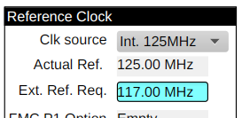
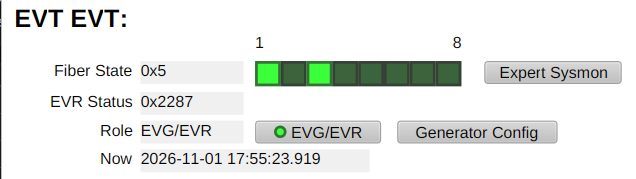
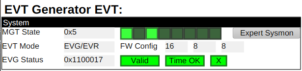
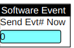
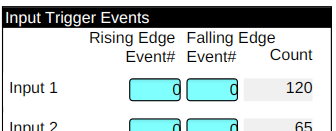
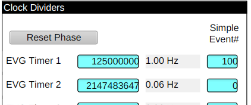
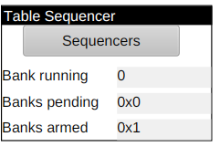
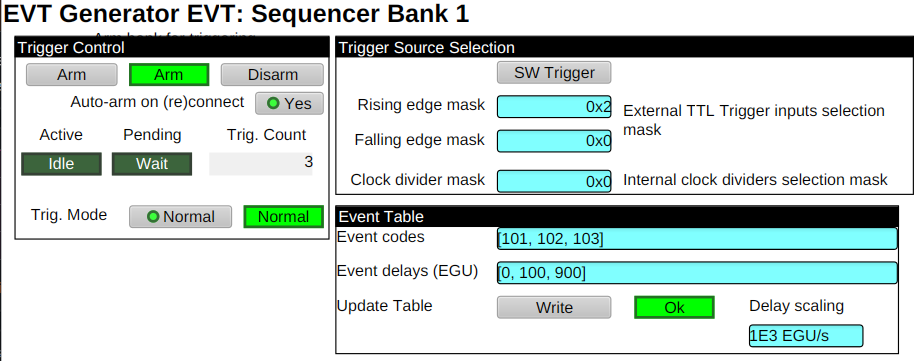
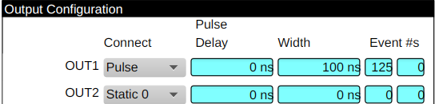
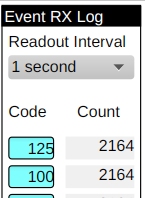

# Timing System

## Timing Chassis Configurations

All configurations have eight (8x) fiber transceivers.

- EVT-8-8
  - 8x LVTTL (3.3v) outputs
  - 8x (LV)TTL Inputs
- EVG-16-2
  - 4x LVTTL (3.3v) outputs
  - 16x (LV)TTL Inputs
  - 2x Reference clock inputs
- EVR-4-16
  - 16x TTL (5v) outputs
  - 4x (LV)TTL inputs

## Event Link model

Timing nodes are connected by unidirectional or bidirectional fiber optic links in a tree topology.
The one-to-many direction away from the root/generator node,
and optional a many-to-one direction towards the root node.
These links send a digital clock and data stream independently in either direction.
Each receiver recovers and uses the transmitter clock for globally synchronous operation.

A link encodes a 16-bit (2 byte) data frame using [8b10b encoding](https://en.wikipedia.org/wiki/8b/10b_encoding)
for clock and data.
So the line rate is twenty times (20x) the frame rate.
The frame rate is determined by a reference clock in the EVG node,
and which is recovered by all Receiver nodes.

Note: the 8b10b encoding process does not include a parity bit or integrity check.

The two bytes in this data frame have two difference meanings.
The first byte is an "event code".
The second byte encodes the "distributed bus" and "data buffer" features.

An event code is a number between 1 and 255.
The Receiver function may be configured to take certain actions when a data frame
with a non-zero event code is received.
Event code zero is the "idle" code, and never causes Receiver action.
Event code N is said to "occur" when a data frame with that number N is received.

The Distributed Bus may be thought of as a set of either (8) digital signals.
The state/value of these signals is updated as each data frame is received,
when the data buffer sub-protocol is not active (default).

The data buffer sub-protocol is a means of sending a variable length data packet.
Currently, not implemented.

### Special Event Codes

Several event codes have a special fixed function.

- 112 (`0x70`) Time stamp shift 0
- 113 (`0x71`) Time stamp shift 1
- 122 (`0x7a`) Heartbeat
- 125 (`0x7d`) Time stamp latch and reset.  aka. Pulse-per-second (PPS) event

## Operation Roles

A timing chassis may operate in either the central Event Generator (`EVG`) role,
or in the Event Receiver/Concentrator role (`EVR/EVG`).

In the EVG role the chassis functions as the node at the root of the event link tree,
with fiber outputs connected to up to 6 chassis acting in the EVR/EVG role.
An EVG chassis may accept as inputs an external reference clock,
and/or a number of digital inputs.
An external reference clock may be used to synchronously drive the fiber transmitters,
providing synchronization for all downstream Receiver chassis.
All outputs from synchronized Receiver nodes will have a stable phase relationship
to the reference clock of the Generator node.

In the EVR/EVG role, a chassis will recover a reference clock from a connected upstream node.
Either a root Generator, or another EVR/EVG node.

## Fiber transceivers

Each timing chassis has eight (8) bidirectional fiber optic transceivers (LC connectors).
These eight are internal specialized for the Receiver logic (first),
and a 1 input 6 output Concentrator.

### Receiver

The Receiver input (1) uses the decoded event stream as described in the Receiver function section.

### Concentrator

The Concentrator connects input 2 with outputs 3 through 8 (fanout direction).
Also, the reverse, connecting inputs 3 through 8 with output 2 (concentrator direction).

When in the EVG role, input/output 2 is not used, and instead the internal Generator logic is connected.

In the fanout direction, the event stream into port 2 (or EVG) is repeated verbatim on outputs 3 through 8.

In the concentrator direction, the event streams coming into ports 3 through 8 are combined into output 2.
The inputs streams are combined through a set of one deep buffers when a non-zero code is received.
This process introduces up to 1 reference clock tick of latency.
The distributed bus bits are combined as a bitwise OR.
Concentration of data buffers is not currently supported.

## Reference clock

The reference clock for a root/Generator (EVG) node may be selected from one of the following sources:

- Internal 125Mhz
  - PPS disciplined
- Internal synthesizer (80Mhz -> 125MHz)
- External (80Mhz -> 125MHz)
  - EVG-16-4 configuration only

Non-root / Receiver nodes will use the Internal synthesizer.



Records:

- `$(P)Ref:Freq` Readback of effective reference frequency.  In megahertz.
- `$(P)MARBLE:MGTCLK0` Reference clock selection
  - `Int. 125MHz`
  - `Int. Synth.`
  - `CLKIN1`
  - `CLKIN2`
- `$(P)Ref:Req` Frequency selection.
  - Ignored for `Int. 125MHz` source.
  - Setting for `Int. Synth`.
  - Information about external source when `CLKIN1` or `CLKIN2` selected.

## Generator function

The Event Generator function logically acts on the state of local inputs,
and produces an event stream.
Actions may be taken based on the local electrical inputs,
and divisions of the reference clock.

In this example, fibers 1 (Receiver input) and 3 (fanout output) are active.
Use the "Generator Config" button to access the EVG screen.
The device mode shows "EVG/EVR", with the generator function active.





Records:

- `$(P)FPGA:Mode:S` Role/Mode setting
- `$(P)FPGA:Mode` Role/Mode readback

When multiple actions occur during the same reference clock tick,
a priority queuing process adjudicates, delaying events from lower priority sources.
This process involves a 1 deep buffer for each event source.

Source priorities (highest to lowest):

```
Sequencer
Timer 0
...
Timer N
Input 0 rising
Input 0 falling
...
Input N rising
Input N falling
Software event
```

### Software Event Source

An event code number sent by software is queued when written.



Records:

- `$(P)EVG:swEvent` Event code number.  Process with a number in the range 1 -> 255.

### Electrical trigger input edge event source

Each electrical input may be assigned two event codes: rising and falling.
These events will be queued when an input state change is detected.
Inputs are sampled using the reference clock.



Records:

- `$(P)EVG:TRIG:$(I):rise` Event code to queue on rising edge
- `$(P)EVG:TRIG:$(I):fall` Event code to queue on falling edge

### Clock Dividers

A bank of 32-bit integer (counting) dividers is provided to produce lower frequency recurring actions
via the associated Single Event Source, or the Sequencer Table Source.
For example, with a 125 MHz reference, a divider value of `125000000` will produce a 1 Hz rate.

The Reset Phase control will synchronously zero all dividers,
allowing a known phase relationship to be established.

For example, with a reference clock frequency of 125 MHz, a divider of 125000000 yields a 1Hz rate.



Records:

- `$(P)EVG:TMR:$(I):divisor` Integer divisor.  Number of reference clock ticks.

### Divider Single Event Source

The configured event number is queued each time the divider action is taken.

- `$(P)EVG:TMR:$(I):event` Event number to queue when the associated counting divider wraps around.

### Sequencer Table Event Source



A Sequencer source accepts a table with two columns: event code number, and delay.
Sequencer operation is designed to follow the model of some arbitrary waveform generators.
When triggered, it begins "playing"/running this table.
A sequencer must be "armed", then triggered, to being running.
While running, a sequence may not be re-triggered.

The trigger mode (Single/Normal) controls whether the "armed" state is cleared (Single)
or remains set (Normal) when a sequence is triggered.

Trigger sources:

- Software (force trigger)
- Clock Dividers
- Input edges (rising/falling)

Table inputs:

- Event code
  - 0, idle code ignored
  - 255, special "stop" code for sequencer.  Not sent.
  - 1 through 254.  Normal event code
- Delay
  - Expressed in controllable EnGineering Units (EGU).
    Ultimately scale and rounded up into integer reference clock tick count.
  - Must increase monotonically

If omitted, a stop code (255) will automatically be appended.
It may be desirable to explicitly append a stop code to effect a trigger hold-off delay.

For example:

With a 125 MHz (8 ns) reference clock, and the `EGU/s` scaling set to `1e9` (delay in nanoseconds).

| Code | Delay |
| --:  | ----: |
|  10  |     0 |
|  20  |    16 |
|  30  |   256 |

On the first reference clock tick after the triggering action,
event 10 will be queued.
Then two ticks later, event 20 will be queued.
Then 29 ticks later, 32 ticks after the trigger, event 30 will be queued.

In the following example a table with three events (101, 102, 103) is armed for repeated
triggering on the rising edge of the second trigger input.



## Receiver function

The Event Receiver function logically acts an event stream,
to produce actions for the local electrical outputs.

### Electrical trigger outputs

Each local electrical output may be connected/driven from one source:

- Static 0 / Static 1
  - Drive with DC low / high level
- Pulse
  - Drive from the associated delay generator



Records:

- `$(P)EVR:OUT:$(N):source` Output source
  - `Static 0`  Output drive DC low
  - `Static 1`  Output drive DC high
  - `Pulse`  Output from delay generator

### Delay generator

Each delay generator produces a binary pattern when triggered.
Initially low for the Delay period,
then high for the Width period,
then low when returning to the idle state.

A delay generator may be triggered on reception of an event code.
Either a single code, or one of several.
By default, control PVs are provided to select up to two events per generator.

Records:

- `$(P)EVR:OUT:$(N):delay` Time from trigger event RX to rising edge in nanoseconds.
- `$(P)EVR:OUT:$(N):width` Time from rising to falling edge in nanoseconds.
- `$(P)EVR:OUT:$(N):evt1` A triggering event code.

### Event Counters

The Event Counters mechanism provides a means of extracting received
event codes into software.
By default, control PVs are provided for up to five (5) events.

The selected events are routed into a hardware FIFO,
which is periodically read out by software.
This FIFO tracks event code and reception time.

During readout, the associated counter PV will be process one for each FIFO entry
with a matching event code.
Update to this PV will carry a hardware timestamp.

This example shows events 125 and 100 being counted.



Records:

- `$(P)EVR:LOG:E.SCAN` Log readout period.
- `$(P)EVR:LOG:evt$(N)` Code setting for logger `N`.
- `$(P)EVR:LOG:cnt$(N)` Reception count for logger `N`.  Has hardware timestamp.

## Technical Reference

### Event Link protocol

8B10B control character usage in two character frame:

- K28.5
  - first character only, frame alignment marker

A receiver establishes the bit phase of incoming event stream by waiting for a successful
reception of a K28.5 character.
A transmitter should send K28.5 occasionally as the first byte in place of a zero event.

Receivers should wait until some number of K28.5 "events" have been received before
using the incoming event stream for any other action.

Absolute time stamp distribution uses special events 112, 113, and 125.
A 32-bit seconds shift register is maintained, as well as a latch seconds register,
and a 32-bit sub-second counter driven by a local clock (typically the reference clock).
Reception of event code 112 shifts a zero into the least significant bit of the seconds shift register.
Reception of code 113 shifts a one.
Reception of code 125 latches the second shift register into the seconds latch register,
and resets the sub-second counter.

Typically, event 125 will be sent by an electrical input connected to a GPS receiver pulse-per-second signal.
Before each pulse starts a second, software will shift out the 32-bit POSIX seconds value using
an event 112 (zero) or 113 (one) for each bit in MSBF order.

An absolute time is established by latching the values of the seconds latch and sub-second counter registers.

TODO: describe data buffer sub-protocol.
