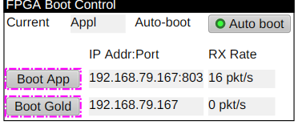

# Boot control

When first powered, a chassis will enter a bootloader mode
allowing the device IP address to be set,
and application firmware to be updated.

See the associated chassis type setup documentation.

- [EVT-8-8](https://github.com/osprey-dcs/osprey-evt-8-8/blob/main/documentation/chassis-setup.md)
- [EVG-16-4](https://github.com/osprey-dcs/osprey-evg-16-4/blob/main/documentation/chassis-setup.md)
- [EVR-4-16](https://github.com/osprey-dcs/osprey-evr-4-16/blob/main/documentation/chassis-setup.md)

Once configured, an IOC should be placed in "autoboot" mode
to automatically reboot into the application firmware whenever
the bootloader mode is detected.

For re-configuration or troubleshooting, switch to "manual" mode
and use to "Boot App" or "Boot Gold" (aka bootloader) buttons to
command an FPGA reload.

Records:

- `$(P)GLD:image` Readback of current FPGA state
  - `None` No communication
  - `Gold` communicating with device in bootloader / golden image mode
  - `Appl` communicating with application mode
- `$(P)GLD:autoboot` Auto reboot setting
